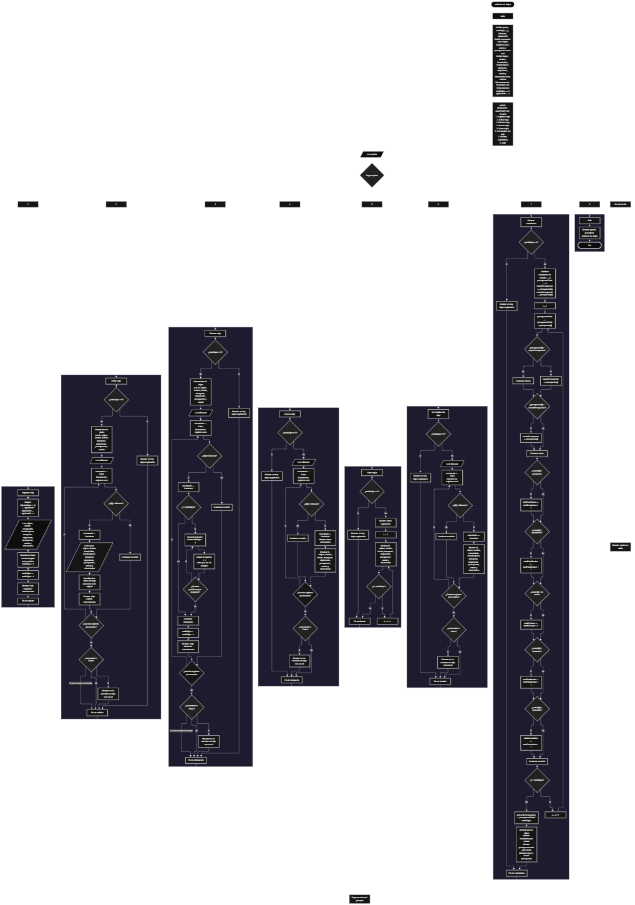

Este proyecto, llamado <b>asistente de viajes</b>, fue desarrollado en <b>pseint</b> como un ejercicio práctico para fortalecer la lógica de programación mediante la creación de un sistema de gestión de viajes desde la consola. El programa cuenta con un menú principal de ocho opciones que permite <b>registrar, editar, eliminar, buscar, listar y consultar los detalles de los viajes</b>, además de mostrar estadísticas generales y finalizar la ejecución. Cada viaje almacena información como el nombre del viajero, el destino, las fechas de salida y regreso, el medio de transporte, el alojamiento, el presupuesto, el estado y una observación. Para organizar los registros, se utilizan diez arreglos paralelos con una capacidad declarada de <b>100 posiciones</b> cada uno. Durante su desarrollo se aplicaron conceptos fundamentales de programación, como variables, arreglos, estructuras condicionales, ciclos repetitivos y estructuras de selección, además de procesos para buscar, modificar, eliminar y analizar registros. Este proyecto permite poner en práctica los conocimientos adquiridos en PSeInt y sirve como base para desarrollar sistemas de gestión de viajes más avanzados utilizando otros lenguajes y tecnologías.

<h2 align="center">⚙️ Funcionamiento del menú principal</h2>

### ➕ Registrar viaje

La opción <b>1) registrar viaje</b> permite almacenar un nuevo viaje en el sistema. Primero, el programa asigna un identificador mediante la instrucción <b>id[totalViajes + 1] &lt;- siguienteID</b> y aumenta la variable <b>siguienteID</b> en uno para generar el próximo identificador. Después, solicita el nombre del viajero, el destino, la fecha de salida, la fecha de regreso, el medio de transporte, el alojamiento, el presupuesto, el estado y una observación. Cada dato se almacena en la posición correspondiente de su respectivo arreglo. Finalmente, incrementa la variable <b>totalViajes</b> en uno y muestra el mensaje <b>"viaje registrado correctamente."</b>. Aunque los arreglos tienen una capacidad declarada de <b>100 posiciones</b>, el código actual no comprueba si existe espacio disponible antes de registrar un nuevo viaje.

### ✏️ Editar viaje

La opción <b>2) editar viaje</b> permite modificar la información de un viaje registrado. Primero, el programa comprueba si la variable <b>totalViajes</b> es igual a cero. Si no hay registros, muestra el mensaje <b>"no hay viajes registrados."</b>. En caso contrario, presenta una lista con el identificador, el viajero, el destino, las fechas, el transporte, el alojamiento, el presupuesto y el estado de cada viaje. Después, solicita el identificador del viaje que se desea editar y utiliza la variable lógica <b>encontrado</b>, inicializada en <b>falso</b>, para determinar si existe una coincidencia. Cuando encuentra el identificador solicitado, cambia la variable a <b>verdadero</b> y solicita los nuevos datos del viajero, destino, fechas de salida y regreso, transporte, alojamiento, presupuesto, estado y observación. La información se actualiza directamente en los arreglos correspondientes, conservando el identificador original. Finalmente, muestra el mensaje <b>"viaje editado correctamente."</b>. Si termina el recorrido sin encontrar el identificador, presenta el mensaje <b>"no se encontro un viaje con ese id."</b>.

### 🗑️ Eliminar viaje

La opción <b>3) eliminar viaje</b> permite eliminar un registro mediante su identificador. Antes de comenzar, el programa comprueba si existen viajes registrados. Si no hay registros, muestra el mensaje <b>"no hay viajes registrados."</b>. Si existen viajes, presenta una lista con el identificador, el viajero, el destino, las fechas, el transporte, el alojamiento, el presupuesto y el estado. Después, solicita el identificador del viaje que se desea eliminar e inicializa la variable <b>encontrado</b> con el valor <b>falso</b>. Si localiza el registro, cambia la variable a <b>verdadero</b> y comprueba si existen posiciones posteriores mediante la condición <b>i &lt; totalViajes</b>. Cuando es necesario, utiliza un ciclo <b>para</b> controlado por la variable <b>j</b> para desplazar una posición hacia la izquierda los datos de los arreglos <b>id, viajero, destino, fechaSalida, fechaRegreso, transporte, alojamiento, presupuesto, estado y observacion</b>. Posteriormente, disminuye la variable <b>totalViajes</b> en uno y muestra el mensaje <b>"viaje eliminado correctamente."</b>. Si no encuentra el identificador solicitado, presenta el mensaje <b>"no se encontro un viaje con ese id."</b>. El código no limpia expresamente la última posición después del desplazamiento y tampoco interrumpe el ciclo exterior tras encontrar un registro, por lo que el comportamiento del recorrido puede verse afectado al modificar <b>totalViajes</b> durante la operación.

### 🔎 Buscar viaje

La opción <b>4) buscar viaje</b> permite localizar un registro mediante su identificador. Primero, el programa comprueba si existen viajes almacenados. Si la variable <b>totalViajes</b> es igual a cero, muestra el mensaje <b>"no hay viajes registrados."</b>. En caso contrario, solicita el identificador que se desea buscar e inicializa la variable lógica <b>encontrado</b> con el valor <b>falso</b>. A continuación, utiliza un ciclo <b>para</b> para recorrer los registros desde la primera posición hasta <b>totalViajes</b>, comparando cada identificador mediante la condición <b>id[i] = idBuscar</b>. Cuando encuentra una coincidencia, cambia la variable a <b>verdadero</b>, muestra el mensaje <b>"datos encontrados"</b> y presenta en una sola línea el identificador, el viajero, el destino, las fechas, el transporte, el alojamiento, el presupuesto, el estado y la observación. Si finaliza el recorrido sin encontrar coincidencias, presenta el mensaje <b>"no se encontro un viaje con ese id."</b>.

### 📋 Listar viajes

La opción <b>5) listar viajes</b> permite visualizar los viajes registrados en el sistema. Antes de mostrar la información, el programa comprueba si la variable <b>totalViajes</b> es igual a cero. Si no existen registros, muestra el mensaje <b>"no hay viajes registrados."</b>. Si hay viajes disponibles, presenta el mensaje <b>"datos registrados"</b> y utiliza un ciclo <b>para</b> para recorrer los arreglos desde la primera posición hasta el total de viajes registrados. Durante el recorrido, muestra el identificador, el nombre del viajero, el destino, la fecha de salida, la fecha de regreso, el medio de transporte, el alojamiento, el presupuesto, el estado y la observación de cada viaje. Esta función permite consultar los registros existentes sin necesidad de buscar individualmente cada viaje.

### 📄 Ver detalles del viaje

La opción <b>6) ver detalles del viaje</b> permite consultar individualmente toda la información de un viaje específico. Primero, el programa comprueba si existen viajes registrados. Si no hay registros, muestra el mensaje <b>"no hay viajes registrados."</b>. En caso contrario, solicita el identificador del viaje y establece la variable <b>encontrado</b> en <b>falso</b>. Después, utiliza un ciclo <b>para</b> para recorrer los registros y comparar sus identificadores. Cuando encuentra el viaje solicitado, cambia la variable a <b>verdadero</b>, muestra el mensaje <b>"detalles del viaje"</b> y presenta por separado cada uno de sus campos: identificador, viajero, destino, fecha de salida, fecha de regreso, transporte, alojamiento, presupuesto, estado y observación. Si el recorrido termina sin encontrar el identificador introducido, muestra el mensaje <b>"no se encontro un viaje con ese id."</b>.

### 📊 Mostrar estadísticas

La opción <b>7) mostrar estadisticas</b> permite obtener un resumen de los viajes registrados y de sus presupuestos. Primero, el programa comprueba si existen registros. Si no hay viajes, muestra el mensaje <b>"no hay viajes registrados."</b>. En caso contrario, inicializa los contadores <b>totalPendientes, totalPlanificados, totalEnCurso, totalFinalizados y totalCancelados</b>, además de la variable acumuladora <b>presupuestoTotal</b>, con el valor cero. También utiliza el primer presupuesto registrado para inicializar <b>mayorPresupuesto</b> y <b>menorPresupuesto</b>. Después, recorre los viajes mediante un ciclo <b>para</b>, suma cada presupuesto al acumulado, compara los valores para identificar el presupuesto mayor y el menor y contabiliza los viajes según su estado. Las comparaciones se realizan con las cadenas exactas <b>"pendiente", "planificado", "en curso", "finalizado" y "cancelado"</b>. Finalmente, calcula el presupuesto promedio mediante la división del presupuesto total entre la cantidad de viajes registrados y muestra el total de viajes, los contadores por estado, el presupuesto total, el promedio, el mayor presupuesto y el menor presupuesto. Las variables utilizadas para estos cálculos no aparecen declaradas explícitamente mediante instrucciones <b>definir</b> en el código compartido.

### 🚪 Salir del menú principal

La opción <b>8) salir</b> permite finalizar la ejecución del programa. Cuando el usuario selecciona esta opción, el sistema muestra el mensaje <b>"gracias por utilizar asistente de viajes."</b>. El menú principal se encuentra dentro de una estructura repetitiva <b>repetir ... hasta que</b>, cuya condición de finalización es <b>hasta que opcion = 8</b>. Por tanto, al seleccionar la opción 8, el ciclo termina después de ejecutar el mensaje de despedida. Si el usuario introduce un valor que no corresponde a las opciones definidas, el bloque <b>de otro modo</b> muestra el mensaje <b>"opcion no valida."</b> y el menú vuelve a presentarse mientras la condición de salida no se cumpla.

<h2 align="center">🧠 Temas aplicados en el proyecto</h2>

### 📦 Variables

En este proyecto se utilizan variables para controlar las opciones del menú, contabilizar los viajes registrados, recorrer los arreglos, almacenar el identificador que se desea buscar y comprobar si una operación ha encontrado un registro. También se utilizan variables para calcular las estadísticas relacionadas con los estados y los presupuestos de los viajes. Cada variable cumple una función específica dentro de las operaciones del sistema.

🔢 **Opcion:** Almacena la opción seleccionada por el usuario en el menú principal.

📊 **TotalViajes:** Almacena la cantidad actual de viajes registrados.

🔄 **I:** Funciona como contador para recorrer los registros y acceder a las posiciones de los arreglos.

🔁 **J:** Controla el recorrido utilizado para desplazar los datos de los viajes durante la eliminación.

🔎 **IdBuscar:** Almacena el identificador introducido por el usuario para localizar un viaje.

🆔 **SiguienteID:** Genera los identificadores consecutivos que se asignan a los nuevos viajes.

✅ **Encontrado:** Variable lógica que indica si se localizó un viaje con el identificador solicitado.

💰 **Presupuesto:** Variable real dimensionada como arreglo para almacenar el presupuesto de cada viaje.

📈 **TotalPendientes, TotalPlanificados, TotalEnCurso, TotalFinalizados y TotalCancelados:** Contabilizan los viajes cuyos estados coinciden exactamente con cada categoría.

💵 **PresupuestoTotal:** Acumula los presupuestos de todos los viajes registrados.

⬆️ **MayorPresupuesto:** Almacena el mayor presupuesto identificado durante el recorrido de los registros.

⬇️ **MenorPresupuesto:** Almacena el menor presupuesto identificado durante el recorrido de los registros.

📊 **PromedioPresupuesto:** Almacena el resultado de dividir el presupuesto total entre la cantidad de viajes registrados.

### 🗃️ Arreglos

En este proyecto se utilizan diez arreglos paralelos para almacenar la información de los viajes. Cada arreglo está dimensionado con <b>100 posiciones</b> y utiliza el mismo índice para representar los datos de un mismo registro. Por ejemplo, la información del primer viaje se distribuye entre <b>id[1], viajero[1], destino[1], fechaSalida[1], fechaRegreso[1], transporte[1], alojamiento[1], presupuesto[1], estado[1] y observacion[1]</b>. Esta organización permite recorrer, buscar, modificar, mostrar y eliminar registros relacionados sin utilizar estructuras de datos adicionales. Aunque la capacidad declarada es de 100 posiciones, el programa no comprueba expresamente el límite antes de registrar un viaje nuevo.

🆔 **Id[100]:** Almacena los identificadores de los viajes registrados.

🧳 **Viajero[100]:** Almacena los nombres de los viajeros.

📍 **Destino[100]:** Almacena los destinos de los viajes.

📅 **FechaSalida[100]:** Almacena las fechas de salida.

📅 **FechaRegreso[100]:** Almacena las fechas de regreso.

🚗 **Transporte[100]:** Almacena los medios de transporte seleccionados.

🏨 **Alojamiento[100]:** Almacena la información del alojamiento.

💰 **Presupuesto[100]:** Almacena los presupuestos correspondientes a cada viaje.

📌 **Estado[100]:** Almacena los estados de los viajes.

📝 **Observacion[100]:** Almacena las observaciones adicionales de cada registro.

### 🔀 Estructuras condicionales

En este proyecto se utilizan las estructuras <b>si</b> y <b>sino</b> para comprobar si existen viajes registrados antes de ejecutar las operaciones, verificar si se encontró un identificador, determinar si es necesario desplazar los datos durante una eliminación y comparar los presupuestos para identificar los valores mayor y menor. También se utilizan condiciones para contar los viajes según sus estados. Estas estructuras permiten que el programa ejecute diferentes instrucciones según los datos almacenados y los resultados de cada comprobación.

### 🔄 Estructuras repetitivas

En este proyecto se utilizan los ciclos <b>para</b> y <b>repetir ... hasta que</b>. Los ciclos <b>para</b> permiten recorrer los arreglos para mostrar, buscar, editar y consultar los viajes registrados. También se utilizan para calcular las estadísticas y desplazar los datos durante la eliminación de un registro. Por otro lado, el ciclo <b>repetir ... hasta que</b> mantiene activo el menú principal y permite ejecutar diferentes operaciones hasta que el usuario selecciona la opción <b>8</b>. De esta manera, el programa puede realizar múltiples operaciones durante una misma ejecución.

### 🎯 Estructura según

El programa utiliza la estructura <b>segun</b> para evaluar el valor almacenado en la variable <b>opcion</b> y ejecutar las instrucciones correspondientes a cada alternativa del menú. Las opciones contempladas son <b>registrar viaje, editar viaje, eliminar viaje, buscar viaje, listar viajes, ver detalles del viaje, mostrar estadisticas y salir</b>. También incluye el bloque <b>de otro modo</b>, que muestra el mensaje <b>"opcion no valida."</b> cuando el valor introducido no coincide con ninguna de las opciones definidas.

### 🔢 Dimensionamiento de arreglos

El programa utiliza la instrucción <b>dimension</b> para establecer 100 posiciones en cada uno de los diez arreglos destinados a almacenar los datos de los viajes. La variable <b>totalViajes</b> controla cuántos registros se consideran activos, mientras que <b>siguienteID</b> genera el identificador de los nuevos viajes. Sin embargo, el código actual no incluye una condición que impida registrar información cuando se alcanza la capacidad máxima declarada de los arreglos.

### 🔄 Reorganización de registros

Durante la eliminación de un viaje, el programa utiliza un ciclo <b>para</b> controlado por la variable <b>j</b> para copiar los datos de las posiciones posteriores sobre la posición del registro eliminado. Este desplazamiento se realiza en los diez arreglos paralelos para mantener relacionados el identificador, el viajero, el destino, las fechas, el transporte, el alojamiento, el presupuesto, el estado y la observación. Después del desplazamiento, la variable <b>totalViajes</b> disminuye en uno. El código no limpia expresamente la última posición ocupada ni interrumpe el ciclo exterior después de encontrar una coincidencia, por lo que no debe interpretarse como un proceso que siempre termina inmediatamente tras eliminar un registro.

### 📊 Cálculos estadísticos

El módulo de estadísticas combina acumuladores, contadores y comparaciones. La variable <b>presupuestoTotal</b> suma los presupuestos de los viajes registrados, mientras que <b>mayorPresupuesto</b> y <b>menorPresupuesto</b> se actualizan al encontrar valores superiores o inferiores a los almacenados. Los contadores de estado aumentan cuando el contenido de <b>estado[i]</b> coincide exactamente con una de las cinco categorías definidas. Por último, <b>promedioPresupuesto</b> se calcula dividiendo el presupuesto total entre <b>totalViajes</b>. Los presupuestos se consideran en los cálculos independientemente del estado del viaje, mientras que los contadores solo incluyen las coincidencias exactas con las cadenas establecidas.

<h2 align="center">¿Cómo se implementaron las operaciones crud en el proyecto?</h2>

Las operaciones <b>crud</b> se implementaron mediante las opciones del menú principal, permitiendo administrar los viajes registrados. La operación <b>crear</b> corresponde a <b>registrar viaje</b>, donde se introduce la información de un nuevo viaje y se asigna un identificador. La operación <b>leer</b> se realiza mediante las opciones <b>buscar viaje, listar viajes y ver detalles del viaje</b>, que permiten consultar los registros de diferentes maneras. La operación <b>actualizar</b> corresponde a <b>editar viaje</b>, donde se reemplazan los datos de un viaje identificado sin modificar su ID. Finalmente, la operación <b>eliminar</b> se realiza mediante la opción <b>eliminar viaje</b>, que desplaza los datos de los registros posteriores y disminuye el contador de viajes. Estas operaciones utilizan variables, arreglos, condicionales y ciclos para gestionar la información almacenada temporalmente durante la ejecución del programa.

<h2 align="center">Diagrama de flujo del proyecto</h2>

<h2 align="center">🛡️ Validaciones del programa</h2>

### 📭 No existen viajes registrados

Esta comprobación se utiliza en las opciones de <b>editar, eliminar, buscar, listar, ver detalles y mostrar estadísticas</b>. El programa verifica si la variable <b>totalViajes</b> es igual a <b>0</b>. Si no existen viajes registrados, muestra el mensaje <b>"no hay viajes registrados."</b> y no continúa con la operación que requiere información almacenada. Esta condición evita intentar localizar o mostrar registros activos cuando el contador indica que no hay viajes disponibles.

### ❌ Viaje no encontrado

Esta comprobación se utiliza durante las operaciones de <b>editar, eliminar, buscar y ver detalles del viaje</b>. El programa inicializa la variable lógica <b>encontrado</b> con el valor <b>falso</b> y recorre los identificadores almacenados mediante un ciclo <b>para</b>. Cuando encuentra una coincidencia con <b>idBuscar</b>, cambia la variable a <b>verdadero</b> y ejecuta las instrucciones de la operación correspondiente. Si finaliza el recorrido y la variable continúa siendo <b>falso</b>, muestra el mensaje <b>"no se encontro un viaje con ese id."</b>. Esta comprobación depende de que el identificador introducido coincida con uno de los registros considerados durante el recorrido.

### 📊 Comparación de presupuestos

Esta comprobación se utiliza en la opción <b>7) mostrar estadisticas</b>. El programa inicializa <b>mayorPresupuesto</b> y <b>menorPresupuesto</b> con el presupuesto del primer viaje registrado. Después, compara el presupuesto de cada registro mediante las condiciones <b>presupuesto[i] &gt; mayorPresupuesto</b> y <b>presupuesto[i] &lt; menorPresupuesto</b>. Cuando encuentra un valor mayor o menor, actualiza la variable correspondiente. Esta operación se realiza únicamente cuando existen viajes registrados, por lo que el programa dispone de una primera posición desde la cual inicializar las comparaciones.

### 📌 Clasificación por estado

En la opción de estadísticas, el programa compara el valor de <b>estado[i]</b> con las cadenas <b>"pendiente", "planificado", "en curso", "finalizado" y "cancelado"</b>. Cuando el estado coincide exactamente con una de ellas, incrementa el contador correspondiente. Si se introduce otro valor, o si el texto no coincide con las cadenas establecidas, el viaje no se contabiliza en ninguno de esos cinco contadores. El código solicita al usuario un estado dentro de las categorías propuestas, pero no incluye una condición que valide la entrada durante el registro o la edición.

### ⚠️ Capacidad de los arreglos

Los diez arreglos están dimensionados con <b>100 posiciones</b>, pero la opción de registro no comprueba si <b>totalViajes</b> ha alcanzado ese límite antes de acceder a la posición <b>totalViajes + 1</b>. Por esta razón, la capacidad máxima está definida en los arreglos, pero no existe una validación explícita que impida superar las posiciones disponibles. El código tampoco incluye comprobaciones específicas para impedir presupuestos negativos, verificar el orden de las fechas o garantizar que los campos de texto contengan valores válidos.

### 🔢 Opción inválida

La estructura <b>segun</b> incluye el bloque <b>de otro modo</b>, que muestra el mensaje <b>"opcion no valida."</b> cuando el usuario introduce un valor distinto de las opciones contempladas en el menú. Las opciones válidas están comprendidas entre <b>1</b> y <b>8</b>, y la condición <b>hasta que opcion = 8</b> establece que la ejecución del menú finaliza cuando se selecciona la opción de salida.

<h2 align="center">🎯 Objetivo del proyecto</h2>

El objetivo principal de este proyecto es fortalecer la <b>lógica de programación</b> mediante el desarrollo de un sistema de gestión de viajes en <b>pseint</b>. A través de su construcción se busca aplicar los conocimientos adquiridos sobre variables, arreglos, estructuras condicionales, ciclos repetitivos y estructuras de selección, integrándolos para resolver un problema de manera organizada. Además, el proyecto permite comprender cómo registrar, consultar, modificar y eliminar información, así como realizar cálculos estadísticos a partir de los datos almacenados. De esta manera, se establece una base para desarrollar sistemas de gestión más completos utilizando otros lenguajes y tecnologías.

